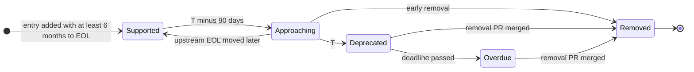
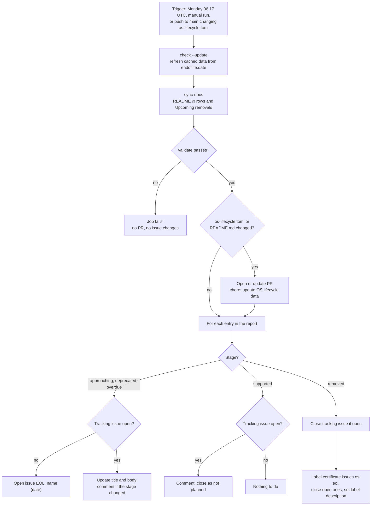
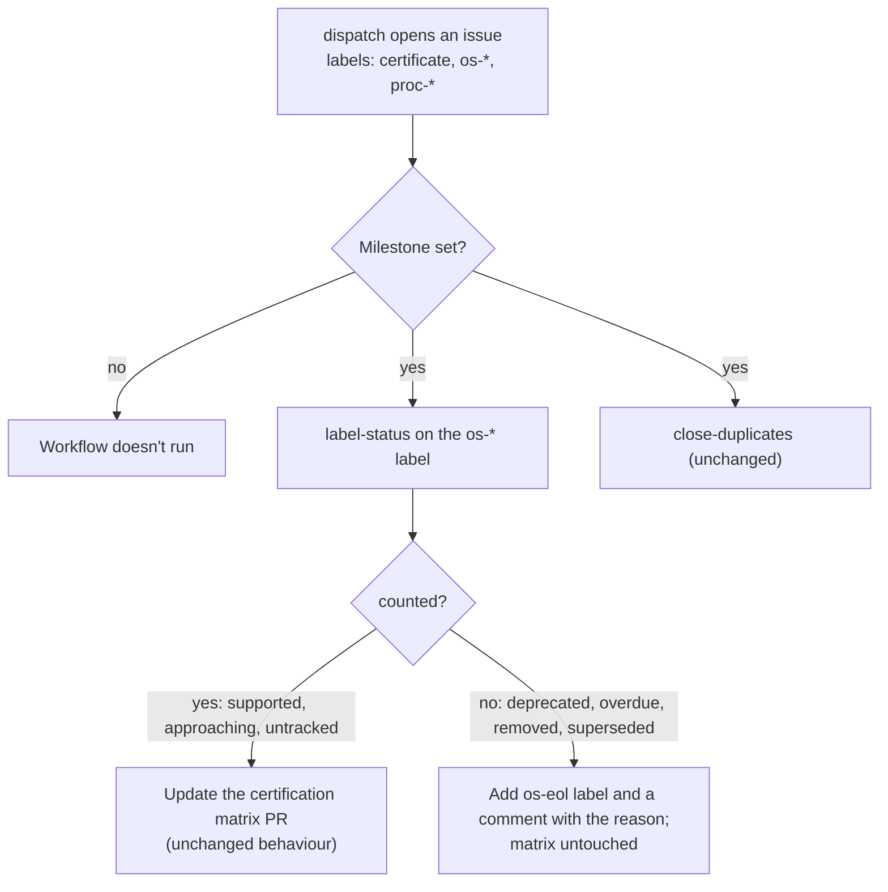
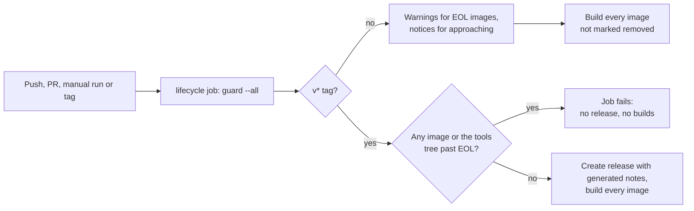

# OS lifecycle (EOL) support: changes and functionality

This document describes the changes that add end-of-life (EOL) handling for
certified operating systems to sev-certify: what was added, how each part
works, and what changes for contributors, maintainers and certification
users.

| Related document | Covers |
|---|---|
| [OS lifecycle policy](os-lifecycle-policy.md) | The rules: EOL definition, stages, timelines, archiving, communication, removal checklist |
| [Manual test guide](os-lifecycle-testing.md) | Step-by-step verification of everything described here |
| This document | What was implemented and how it works |

## 1. Summary

Before these changes, sev-certify had no record of when an OS reaches EOL.
EOL releases (Fedora 41, Ubuntu 25.04, Ubuntu 25.10) stayed in the build
matrix, kept getting new certificates, shipped in tagged releases, and still
showed ✅ in the README.

The changes add:

- **A source of truth:** EOL dates for every image and for the mkosi build
  tools tree, in `images/os-lifecycle.toml`.
- **Automatic tracking:** a weekly workflow compares those dates with
  [endoflife.date](https://endoflife.date), opens tracking issues 90 days
  before EOL, and keeps the README up to date.
- **Guards:** tagged releases can't ship EOL images, and new certificates for
  EOL OSes are recorded but kept out of the certification matrix.
- **Archiving instead of deletion:** at removal, certification results move
  to an archive table, and the OS's certificate issues are labelled and
  closed.
- **Tooling for a clean removal:** one command (`drop`) performs the removal
  checklist.
- **Generated release notes** listing removed OSes and OSes approaching EOL.

The test harness and CLI (`sev_verify`) are unchanged: they read the OS
identity from `/etc/os-release` at runtime and have no per-OS logic.

## 2. How it fits together

```
                       endoflife.date API
                               │ weekly
                               ▼
 images/os-lifecycle.toml ◀── os-eol-check.yml ──▶ "EOL: <OS> (<date>)" tracking issues
   (EOL dates, labels)         │                   (open at T-90, comment on stage change,
          │                    │                    close on removal)
          │                    ├──▶ PR "chore: update OS lifecycle data"
          │                    │    (changed dates, 🔚 rows, "Upcoming removals" in README.md)
          │                    └──▶ after removal: certificate issues labelled os-eol and closed
          │
          ├──▶ build-and-release.yml   lifecycle job: build matrix, EOL gate
          │                            (tags fail, other builds warn), release notes
          ├──▶ update-certification-matrix.yml   EOL / superseded results not counted
          ├──▶ lint.yml                validation, onboarding rule, unit tests
          └──▶ images/Makefile         `make lifecycle`, warning on EOL image builds

 scripts/os_lifecycle.py drop <key>  ──▶ removes images, marks entry removed,
                                         archives matrix rows, lists leftover references
```

Every component calls `scripts/os_lifecycle.py`, so the stage rules are
implemented once.

## 3. Requirements and where they are implemented

| Requirement | Implementation |
|---|---|
| Detect and track EOL dates for certified OSes | `images/os-lifecycle.toml` caches dates. `os-eol-check.yml` refreshes them weekly from endoflife.date through a PR, and opens tracking issues. `check` also reports new upstream releases eligible for onboarding and testing releases that became stable. |
| Criteria and timeline for deprecating an EOL OS | Stages computed by `Entry.stage()`: Supported → Approaching EOL (*T* − 90 days) → Deprecated (*T*) → removal due by *T* + 30 days, with optional approved extensions capped at *T* + 90. Enforced by the build gate (tags fail), the `lint` onboarding rule (≥ 6 months to EOL), and tracking-issue comments. |
| Marking existing certification results | Flag, then archive: 🔚 in the README at *T* (`sync-docs`), rows moved to *End-of-Life OS Certifications (Archived)* in `docs/certifications.md` at removal (`drop`/`archive`), certificate issues labelled `os-eol` and closed after removal (`os-eol-check.yml`). New results for EOL OSes are labelled `os-eol` and not counted (`update-certification-matrix.yml`). Nothing is deleted. |
| Communication when an OS is phased out | Tracking issue at *T* − 90 with successor candidates and next steps, a comment on every stage change, the README "Upcoming removals" note at *T*, a suggested removal PR title from `drop`, and generated release notes for the next tag. Stakeholder emails remain manual (policy section 7). |
| Updates to drop support cleanly | `drop` deletes the image directories, marks the entry removed (which drops it from the generated build matrix), updates the README and archive table, and lists remaining doc references and distro-specific files. Post-merge issue handling is automatic. |

## 4. New files

| File | Purpose |
|---|---|
| `images/os-lifecycle.toml` | Lifecycle data: one entry per image pair, plus `[tools-tree]` |
| `scripts/os_lifecycle.py` | CLI with all the lifecycle logic. Python 3.11+, standard library only (`tomllib`, `urllib`) |
| `scripts/tests/test_os_lifecycle.py` | 30 `unittest` tests against a fixture repo, plus a check that the real `os-lifecycle.toml` is valid |
| `.github/workflows/os-eol-check.yml` | Weekly EOL check, update PR, tracking issues, certificate archiving |
| `docs/os-lifecycle-policy.md` | The policy, updated to describe the implementation |
| `docs/os-lifecycle-testing.md` | Manual test guide |
| `docs/os-lifecycle-changes.md` | This document |

## 5. Modified files

| File | Change | Before → after |
|---|---|---|
| `.github/workflows/build-and-release.yml` | New `lifecycle` job that `create-release` and `build` depend on. It runs `guard --all` (`--strict` on `v*` tags) and outputs the build matrix. | Hard-coded 10-entry matrix → generated from `os-lifecycle.toml`. EOL images could ship in tags → tag builds fail before a release is created. |
| | Tag releases get notes from `release-notes`. The checkout uses `fetch-depth: 0` to find the previous tag's date. | Fixed text "OS images for <tag> certification" → that line plus *Removed (end-of-life)* and *Approaching end-of-life* sections. |
| `.github/workflows/update-certification-matrix.yml` | New steps: **Check OS lifecycle** (`label-status`) and **Record EOL certification**. The matrix update step only runs for counted labels. Adds the `issues: write` permission. | Any certificate updated or re-inserted a matrix row → EOL, removed and superseded-minor results get an `os-eol` label and an explanatory comment, and the matrix is untouched. |
| `.github/workflows/lint.yml` | New `os lifecycle` job: unit tests, `validate --base-ref origin/<base>` on PRs, and the `status` table. | No checks → PRs fail on lifecycle file inconsistencies or onboarding-rule violations. |
| `images/Makefile` | New `lifecycle` target, and a `guard` call before each image build (never fails). | Silent → a warning when building an EOL image locally. |
| `README.md` | 🔚 legend entry, `os-lifecycle:upcoming-removals` markers, link to the archive section. | — |
| `docs/certifications.md` | New *End-of-Life OS Certifications (Archived)* section and contents entry. | — |
| `docs/how-to-add-new-os-images.md` | "Integrate into GitHub workflow" step replaced by "Register in the OS lifecycle file", with the onboarding rule and a `validate` command. | Contributors edited the workflow matrix → they add a TOML entry. |
| `docs/how-to-generate-certs.md` | Note that results for EOL or superseded OSes are posted but not added to the matrix. | — |
| `images/README.md` | `make lifecycle` and the EOL build warning. | — |

## 6. Lifecycle data model

Each table in `images/os-lifecycle.toml` describes one image pair. The key is
the image suffix, so `[fedora-44]` means `images/host-fedora-44` and
`images/guest-fedora-44`, and the build matrix gets
`distro: fedora, release: 44`. Keys containing a dot must be quoted
(`["ubuntu-26.04"]`).

| Field | Required | Meaning |
|---|---|---|
| `product` | yes | endoflife.date product slug (`fedora`, `ubuntu`, `debian`, `centos-stream`, `rocky-linux`, `opensuse`) |
| `cycle` | yes | endoflife.date release name (`44`, `26.04`, `testing`) |
| `eol` | yes | Cached `eolFrom` date, or `"none"` for testing releases |
| `os_label` | yes, except `[tools-tree]` | GitHub label that `beacon-report.sh` puts on certificate issues (`os-<ID>-<VERSION_ID>`) |
| `minor_releases` | no | `true` if labels and matrix rows are per minor release (Rocky: `os-rocky-10.3`) |
| `latest_minor`, `latest_minor_date` | with `minor_releases` | Cached latest minor and its GA date. Older minors are *superseded*. |
| `codename` | no | For testing releases: the check reports when this codename becomes a stable release |
| `extended_until` | no | Approved extension of the removal deadline, at most `eol` + 90 days |
| `state`, `removed`, `last_release` | set by `drop` | `state = "removed"`, the removal date, and the last tagged release with the images. Removed entries stay in the file so their labels are still recognised. |

Unknown fields are rejected, so a typo such as `eoll` fails instead of being
ignored.

The matrix row name isn't stored. It's derived from `os_label` the same way
`update-certification-matrix.yml` derives it (`os-opensuse-leap-16.0` →
`Opensuse leap 16.0`) and matched case-insensitively, so the two can't drift
apart.

### Stages

For an entry with EOL date *T*:

| Stage | When | Effect |
|---|---|---|
| `supported` | before *T* − 90, or `eol = "none"` | None |
| `approaching` | *T* − 90 ≤ today < *T* | Tracking issue, `notice` in builds, listed in release notes |
| `deprecated` | *T* ≤ today ≤ deadline | Tag builds fail, other builds warn, results not counted, README 🔚 |
| `overdue` | after the deadline | As deprecated, plus an "overdue" comment on the tracking issue |
| `removed` | `state = "removed"` | Not built, results not counted, certificate issues archived |

The deadline is *T* + 30 days, or `extended_until` if set. For `[tools-tree]`
the deadline is *T* itself, because the tools tree must be bumped before EOL.

Two stages apply only to certificate labels (`label-status`):

- `superseded`: a Rocky minor older than `latest_minor`. It isn't counted,
  and its README row gets 🔚 90 days after the newer minor's GA.
- `untracked`: a label with no entry. It's counted as before, so certificates
  for OSes outside this repository keep working.

## 7. `scripts/os_lifecycle.py` reference

Global options: `--root <dir>` (default: repository root) and
`--today YYYY-MM-DD` (evaluate as of another date; used for testing and
previews).

| Subcommand | What it does | Used by | Exit code |
|---|---|---|---|
| `status` | Prints a table of each entry's stage, EOL date and deadline | `make lifecycle`, `lint.yml` | 0 |
| `check [--update] [--report F] [--summary]` | Fetches endoflife.date and finds changed EOL dates and Rocky minors, testing releases that became stable, and onboarding candidates (newer than anything tracked, ≥ 180 days to EOL). `--update` rewrites the cached values in place, keeping comments. `--report` writes the JSON consumed by `os-eol-check.yml`. `--summary` prints markdown. | `os-eol-check.yml` | 0. Fetch failures are reported as warnings, and cached data is used. |
| `guard [IMAGE…] [--all] [--strict]` | Annotates approaching (`notice`) and EOL (`warning`, or `error` with `--strict`) images, always including the tools tree. Accepts `host-<key>`, `guest-<key>` or `<key>`. | `build-and-release.yml`, `images/Makefile` | 1 only with `--strict` and an EOL or untracked image |
| `label-status LABEL [--github-output]` | Classifies a certificate's `os-*` label. Outputs `stage`, `counted`, `name`, `eol`, `reason`. | `update-certification-matrix.yml` | 0 |
| `matrix` | Prints `{"include": [{"distro", "release"}, …]}` for every image entry not removed | `build-and-release.yml` | 0 |
| `validate [--base-ref REF]` | Every `images/{host,guest}-*` directory has an entry, every active entry has both directories, removed entries have none, `[tools-tree]` matches `ToolsTreeRelease`, extensions are within the cap. With `--base-ref`, entries absent on that ref must have ≥ 180 days to EOL. | `lint.yml`, `os-eol-check.yml` | 1 on any error |
| `sync-docs` | In `README.md`, sets 🔚 on rows of deprecated/overdue OSes and superseded minors (after 90 days), and rewrites the "Upcoming removals" block. Idempotent. | `os-eol-check.yml` | 0 |
| `release-notes --tag T [--since DATE]` | Release notes: OSes removed on or after `DATE`, and OSes approaching EOL | `build-and-release.yml` (tags) | 0 |
| `archive --name N [--eol D] [--last-release T]` | Removes README rows named `N` and moves its `docs/certifications.md` rows to the archive table, one row per processor | Maintainers (superseded Rocky minors) | 0 |
| `drop KEY [--last-release T]` | The removal checklist: `git rm` both image directories, set `state`/`removed`/`last_release`, archive the rows, update the README, then print follow-ups (doc references found with `git grep`, distro-specific files if it was the last release of that distro, suggested PR title). `last_release` defaults to the latest `v*` tag. | Maintainers | 1 if the entry doesn't exist or is already removed |

Archive rows look like this:

```
| Fedora 41 | 2025-12-15 | EPYC 7003 | [c3.0.0-1](…/issues/353) | v3.0.0-1 | 2026-11-24 |
```

The processor column says `EPYC 7003`, not `AMD EPYC 7003`, so
`update-certification-matrix.yml`'s table search (lines starting with
`AMD EPYC <series>`) never finds the archive.

## 8. Workflows in detail

### 8.1 `os-eol-check.yml` (new)

- **Triggers:** every Monday at 06:17 UTC, `workflow_dispatch`, and pushes to
  `main` that change `images/os-lifecycle.toml` (so a merged removal is
  processed right away).
- **Permissions:** `contents`, `issues` and `pull-requests`: write.
- **Concurrency:** one run at a time.

Steps:

1. **Check upstream EOL dates:** `check --update --report … --summary`
   (summary goes to the run page), then `sync-docs` and `validate`.
2. **Open PR with lifecycle updates:** `peter-evans/create-pull-request@v7`
   commits any change to `os-lifecycle.toml` and `README.md` to
   `os-lifecycle/auto-update`. It opens or updates the PR
   *chore: update OS lifecycle data*, labelled `os-eol`. When nothing
   changed, no PR is opened.
3. **Sync tracking and certificate issues** (`actions/github-script`), driven
   by the JSON report:
   - Creates the `os-eol` label if missing.
   - For each entry approaching EOL, deprecated or overdue, opens an
     `EOL: <name> (<eol>)` issue, or updates the title and body of the
     existing one. Issues are matched by a hidden
     `<!-- os-lifecycle key=<key> stage=<stage> -->` marker, so a changed
     date or edited title never creates duplicates.
   - If the stage in the marker differs from the current stage, it posts a
     comment, for example "…is now Deprecated. Tagged builds fail until it is
     removed" or "⚠️ The removal deadline … has passed".
   - Closes the tracking issue when the OS is removed (*completed*) or its EOL
     moved outside the 90-day window (*not planned*).
   - For removed entries:
     - every label matching the entry (all minors for Rocky) gets the
       description `EOL <date> — archived`;
     - every `certificate` issue with that label gets `os-eol`;
     - open ones are closed as *completed*, with a comment linking to the
       archive.

### 8.2 `build-and-release.yml` (modified)

```
lifecycle ──▶ create-release (push / dispatch with replace_release)
          └─▶ build (matrix from lifecycle output)
```

- On `refs/tags/v*`, `guard --all --strict` fails the `lifecycle` job if any
  image or the tools tree is past EOL. `create-release` and every build are
  then skipped, so no partial release is created.
- On other events, the same check produces warning annotations and the build
  continues.
- Job names are unchanged (`<distro>-<release>`), so required status checks
  keep working.

### 8.3 `update-certification-matrix.yml` (modified)

When a certificate issue is opened with a milestone:

1. `jq` extracts the first `os-*` label, ignoring `os-eol`.
2. `label-status` writes `counted`, `reason` and `name` to the step outputs.
3. If `counted == false`, the issue gets `os-eol` and a comment such as
   *"Fedora 41 reached upstream end-of-life on 2025-12-15 and is scheduled for
   removal by 2026-01-14. This result is recorded but not added to the
   certification matrix…"*, and the matrix update is skipped.
4. Otherwise the existing matrix update runs unchanged.

The `close-duplicates` job is unchanged.

### 8.4 `lint.yml` (modified)

The new `os lifecycle` job runs on every PR and push to `main`. It runs the
unit tests, `validate` (with `--base-ref origin/<base branch>` on PRs to
enforce the onboarding rule), and `status`.

## 9. Automated EOL processing workflow

Section 8 describes each workflow on its own. This section follows an OS
from start to finish through the automation: what starts each step, what
happens without anyone acting, and where a maintainer has to step in.

### 9.1 Triggers

| Event | Workflow or tool | What gets processed |
|---|---|---|
| Every Monday at 06:17 UTC, or **Run workflow** | `os-eol-check.yml` | Every entry: upstream dates, stages, README, tracking issues, archiving |
| Push to `main` that changes `images/os-lifecycle.toml` (removal PR, merged weekly PR, manual edit) | `os-eol-check.yml` | Same as above, so merged changes are processed right away |
| Certificate issue opened with a milestone (by dispatch) | `update-certification-matrix.yml` | Whether the result counts toward the matrix |
| Pull request, or push to `main` | `lint.yml`, `build-and-release.yml` | Validation and onboarding rule; EOL warnings; generated build matrix |
| Push of a `v*` tag | `build-and-release.yml` | Strict EOL gate; generated release notes |
| `make <image>` locally | `images/Makefile` | EOL warning before the build |

There are two kinds of automation, and they react at different speeds:

- **Date-driven guards react the same day.** `guard` and `label-status` work
  out the stage from today's date and the cached dates in
  `os-lifecycle.toml` on `main` whenever they run. A tag build on the EOL date
  fails, and a certificate opened on that date isn't counted, without any PR
  or workflow run.
- **Weekly-run actions react within a week.** Tracking issues, stage-change
  comments and the README PR happen on the first `os-eol-check` run on or
  after the boundary date, so up to 7 days later unless someone runs the
  workflow by hand.

Cached dates also lag. The weekly run refreshes dates from endoflife.date
inside the runner, so tracking issues and the README PR use the **upstream**
dates straight away. The guards on `main` keep using the **cached** dates
until the weekly PR is merged.

### 9.2 Lifecycle stages



The deadline is *T* + 30 days (`extended_until` if set; *T* for the tools
tree). Every stage except Removed is worked out from the date. Removed is the
only stage set by a commit (`state = "removed"`, written by `drop`).

### 9.3 What happens at each stage

| Stage entered | Detected by | Automated | Manual |
|---|---|---|---|
| **Upstream date changes** (any time) | Weekly `check` | PR *chore: update OS lifecycle data* updates the cached `eol`. Tracking issue title and body show the new date in the same run. | Review and merge the PR. The guards on `main` use the new date only after the merge. |
| **Approaching EOL** (*T* − 90) | Weekly run; guards at build time | Tracking issue `EOL: <name> (<eol>)` opened (dates, successor candidates, next steps). `notice` annotations in builds. Listed under *Approaching end-of-life* in tag release notes. | Onboard the successor, announce to stakeholders, decide on any extension |
| **Deprecated** (*T*) | Guards at build time (same day); weekly run | Tag builds fail. Main/PR builds and `make` warn. New certificates get `os-eol` and a comment and aren't counted. On the next weekly run: stage comment on the tracking issue, and the README PR sets the row to 🔚 and lists the OS under *Upcoming removals*. | Merge the README PR. Run `drop <key>` and open the removal PR. |
| **Overdue** (after the deadline) | Weekly run | Comment *"⚠️ The removal deadline … has passed"* with the `drop` command | Remove now, or record an approved `extended_until` |
| **Removed** (removal PR merged) | Push to `main` changes `os-lifecycle.toml` | Tracking issue closed as *completed*. Every `certificate` issue with the OS label gets `os-eol`, and open ones are closed with a link to the archive. Label description set to `EOL <date> — archived`. Image left out of the build matrix. Listed under *Removed (end-of-life)* in the next tag's release notes. | Check the run. Post the final stakeholder note. |
| **After removal** | Every weekly run; each new certificate | New certificates for the OS get `os-eol` and a *"was removed from sev-certify"* comment. The archiving pass runs again every week, so certificate issues opened later for a removed OS are labelled and closed too. | None |

Special cases:

| Case | Automated | Manual |
|---|---|---|
| **Rocky minor superseded** (new minor GA) | Weekly PR updates `latest_minor`/`latest_minor_date`. Once merged, certificates for older minors are `superseded` and not counted. 90 days after GA, the weekly PR sets their README rows to 🔚. | Certify the new minor, then `archive` the older rows |
| **Tools tree approaching EOL** | Tracking issue at *T* − 90. Overdue from *T* + 1 (no grace period). Tag builds fail from *T*. | Bump `ToolsTreeRelease` and `[tools-tree]` together. The push triggers a run that closes the issue because the new EOL is outside the window. |
| **Upstream EOL moved later**, out of the 90-day window | The tracking issue gets a comment and is closed as *not planned*. It reopens as a new issue when the window is reached again. | Merge the weekly PR |
| **Testing release becomes stable** (e.g. Debian forky → 14) | Reported under *Events* in the run summary only | Rename the images and entry (policy section 3) |
| **New upstream release eligible for onboarding** | Listed in the run summary, and as a successor candidate in the same product's tracking issue | Decide whether to onboard |

### 9.4 Weekly run (`os-eol-check.yml`)



### 9.5 New certificate issue (`update-certification-matrix.yml`)



### 9.6 Build and release gate (`build-and-release.yml`)



### 9.7 Example: Fedora 44 (EOL 2027-06-02)

Assuming no manual runs and no change to the upstream date:

| Date | What happens |
|---|---|
| 2027-03-04 (Thu) | *T* − 90. Builds show a `notice` the same day. Tag release notes list Fedora 44 under *Approaching end-of-life*. |
| 2027-03-08 (Mon) | Weekly run opens `EOL: Fedora 44 (2027-06-02)` with Fedora 45 as successor candidate, and `EOL: Build tools tree (Fedora 44) (2027-06-02)`. |
| 2027-06-02 (Wed) | *T*. Tag builds fail, main builds warn, new Fedora 44 certificates aren't counted, all from that day. |
| 2027-06-07 (Mon) | Weekly run comments *"…is now Deprecated"* and opens the README PR with Fedora 44 set to 🔚 and listed under *Upcoming removals*. |
| 2027-07-02 | Last day of the 30-day grace period |
| 2027-07-05 (Mon) | Weekly run comments that the removal deadline passed |
| Removal PR merged | The push run closes the tracking issue, then labels and closes the Fedora 44 certificate issues |

### 9.8 Failure handling and re-runs

| Situation | Behaviour |
|---|---|
| endoflife.date unreachable, or a product/release missing | Warning annotation and a *Problems* section in the run summary. The affected entries keep their cached data, and issues are still synced from it. The run doesn't fail. |
| `os-lifecycle.toml` invalid after the update, or README markers missing | The first step fails, so no PR is opened and no issue is changed. Fix and re-run. |
| Workflow re-run, or two runs on the same day | Safe. Issues are matched by the hidden marker, stage comments are posted only when the stage changes, and archiving skips issues already labelled and closed. |
| Tracking issue title or body edited by hand | Overwritten on the next run. Put discussion in comments. |
| Tracking issue closed by hand while still in the window | A new one is opened on the next run, because only open issues are matched. |
| Weekly PR not merged | Issues and the run summary show upstream dates, but the guards on `main` keep using the cached ones. |

## 10. What changes for each audience

**Contributors adding an OS**
- Add an entry to `images/os-lifecycle.toml` instead of editing the workflow
  matrix.
- The release must have at least 6 months of upstream support left, or
  `lint` fails.
- `python3 scripts/os_lifecycle.py validate --base-ref origin/main` checks the
  entry locally.

**Maintainers**
- Expect `EOL: …` issues 90 days before each EOL, and a weekly
  *chore: update OS lifecycle data* PR to review and merge.
- Remove an EOL OS with `python3 scripts/os_lifecycle.py drop <key>`, fix the
  references it lists, and open the PR. Issue clean-up happens after merge.
- Before tagging, run `python3 scripts/os_lifecycle.py guard --all --strict`.
  A tag can't be released while any image is past EOL.
- When bumping `ToolsTreeRelease`, update `[tools-tree]` in the same PR.

**Certification users (dispatch)**
- Results for EOL or superseded OSes are still posted as issues, but labelled
  `os-eol` with an explanatory comment, and not shown in the matrix.
- Archived results stay reachable in `docs/certifications.md`, and old tagged
  releases are never modified.

## 11. State and impact when merged

As of 2026-11-24:

| Item | Status |
|---|---|
| Fedora 41 (EOL 2025-12-15), Ubuntu 25.04 (2026-01-17), Ubuntu 25.10 (2026-07-01) | Removal overdue. **`v*` tag builds fail until they are dropped.** Main builds show warnings. |
| First `os-eol-check` run | Opens 3 tracking issues and a PR marking those 3 README rows 🔚 |
| Rocky 10.0–10.2 rows | Superseded by 10.3 (GA 2026-11-16). New 10.0–10.2 results aren't counted. Rows get 🔚 from 2027-02-14 unless archived after 10.3 is certified. |
| Fedora 44 and the tools tree (EOL 2027-06-02) | Tracking issues open on 2027-03-04. Fedora 45 is already reported as an onboarding candidate. |
| Cached EOL dates | Matched endoflife.date when the changes were made |

## 12. Order of execution

The changes depend on each other, so roll them out in this order:

- The workflows call `scripts/os_lifecycle.py`, so the script must be on
  `main` first.
- `sync-docs`, `drop` and `archive` need the README markers and the archive
  section in `docs/certifications.md`.
- Once merged, tagged releases are blocked until the overdue OSes are
  removed.

```
Phase 1          Phase 2           Phase 3              Phase 4             Phase 5         Phase 6
sign-off,  ──▶   merge tooling ──▶ automatic first ──▶  drop the 3 EOL ──▶  next tagged ──▶ ongoing,
testing,         PR                run (issues + PR)    OSes                release         dated steps
announcement                       no tags yet!
```

### Phase 1: Before merging

| # | Step | How | Why it comes first |
|---|---|---|---|
| 1.1 | Get maintainer sign-off on the policy | Resolve the open questions in [policy section 11](os-lifecycle-policy.md#11-open-questions-for-maintainer-sign-off), then change its **Status** from *Proposed* to *Accepted* | The answers can change constants in `scripts/os_lifecycle.py` (`WARN_DAYS`, `GRACE_DAYS`, `MAX_EXTENSION_DAYS`, `ONBOARDING_MIN_DAYS`) or the Debian `eol` dates. That's cheaper before merge. |
| 1.2 | Run the local tests | [Test guide](os-lifecycle-testing.md) Part A | Confirms the script before anything depends on it |
| 1.3 | Run the workflow tests in a fork | Test guide Part B | The `github-script` code hasn't been executed yet |
| 1.4 | Check settings on `AMDEPYC/sev-certify` | Issues enabled. **Settings → Actions → General**: *Read and write permissions* and *Allow GitHub Actions to create and approve pull requests*. If actions are restricted to an allow-list, allow `peter-evans/create-pull-request`. | Otherwise `os-eol-check` fails on its first run in Phase 3 |
| 1.5 | Announce the change to stakeholders | Partner/OSV contacts, dispatch users, test labs (policy section 7). Say that Fedora 41, Ubuntu 25.04 and Ubuntu 25.10 will be removed, that `v3.0.0-1` is the last release with their images, and that new results for them won't be counted. | Merging changes how their results are counted straight away |

### Phase 2: Merge the tooling

Open one PR with the commits in this order. Each commit leaves the
repository consistent, and the commit types pass the `lint` conventional
commit check.

| # | Commit | Files | Depends on |
|---|---|---|---|
| 2.1 | `feat: add OS lifecycle data and tooling` | `images/os-lifecycle.toml`, `scripts/os_lifecycle.py`, `scripts/tests/test_os_lifecycle.py` | Nothing |
| 2.2 | `docs: add EOL legend and archive section to certification matrix` | `README.md`, `docs/certifications.md` | Nothing, but must land before anything runs `sync-docs`, `drop` or `archive`, which fail without the markers and archive heading |
| 2.3 | `ci: add OS lifecycle checks to workflows and Makefile` | `.github/workflows/build-and-release.yml`, `update-certification-matrix.yml`, `lint.yml`, `os-eol-check.yml`, `images/Makefile` | 2.1 (calls the script), 2.2 (`os-eol-check` runs `sync-docs`) |
| 2.4 | `docs: add OS lifecycle policy, changes and test guide` | `docs/os-lifecycle-policy.md`, `docs/os-lifecycle-changes.md`, `docs/os-lifecycle-testing.md`, `docs/how-to-add-new-os-images.md`, `docs/how-to-generate-certs.md`, `images/README.md` | 2.3 (describes the workflows) |

Stage files by explicit path. Don't use `git add -A`: the working tree has
untracked build output (for example `images/guest-ubuntu-26.04/mkosi.tools/`)
and backup directories that must not be committed.

**Expected on the PR:**
- `lint` → **os lifecycle** passes. The onboarding rule doesn't apply here,
  because the base branch has no lifecycle file yet.
- `build-images` shows the new **os lifecycle** job with 3 warnings, followed
  by the same 10 build jobs as before.

### Phase 3: Right after the merge (automatic)

The merge commit starts two workflows:

| Workflow | Result | Your action |
|---|---|---|
| `build-images` (push to `main`) | `devel` is rebuilt as before. The **os lifecycle** job shows 3 warnings. | None |
| `os-eol-check` (push changed `images/os-lifecycle.toml`) | Creates the `os-eol` label, 3 tracking issues (`EOL: Fedora 41 (2025-12-15)`, `EOL: Ubuntu 25.04 (2026-01-17)`, `EOL: Ubuntu 25.10 (2026-07-01)`), and the PR *chore: update OS lifecycle data* marking those README rows 🔚 | Check the run summary and the issues. If Phase 4 will take more than a few days, merge the PR so the README shows the EOL status meanwhile. Otherwise leave it open. |

**Don't push a `v*` tag yet.** The **os lifecycle** job fails every tag
build until Phase 4 is done.

### Phase 4: Remove the overdue OSes

Use one combined PR or one PR per OS:

```bash
git fetch origin --tags
git switch -c chore/drop-eol-oses origin/main
python3 scripts/os_lifecycle.py drop fedora-41    --last-release v3.0.0-1
python3 scripts/os_lifecycle.py drop ubuntu-25.04 --last-release v3.0.0-1
python3 scripts/os_lifecycle.py drop ubuntu-25.10 --last-release v3.0.0-1
```

1. Fix the references that `drop` lists. For Fedora 41 these are the examples
   in `images/README.md`, `docs/how-to-run-guest-manually.md`,
   `modules/build/guest/README.md` and
   `modules/test/guest/attestation-workflow/README.md`. Replace them with a
   long-lived release such as `ubuntu-26.04`. Fedora 44 and Ubuntu 26.04
   remain, so no distro-specific build files need cleaning up.
2. Commit, for example `chore: drop Fedora 41, Ubuntu 25.04 and Ubuntu 25.10
   (EOL)`. Paste the [policy section 8](os-lifecycle-policy.md#8-removal-checklist)
   checklist into the PR description and link the tracking issues.
3. Merge. `os-eol-check` then runs automatically and:
   - closes the 3 tracking issues;
   - adds `os-eol` to every `certificate` issue for those OSes and closes the
     open ones with an archive comment;
   - sets the label descriptions to `EOL <date> — archived`.
4. If the Phase 3 PR *chore: update OS lifecycle data* is still open, close
   it. It's now obsolete, and the next run won't recreate it because no OS is
   past EOL.
5. Confirm that tags are unblocked:
   ```bash
   git pull && python3 scripts/os_lifecycle.py guard --all --strict; echo "rc=$?"   # rc=0
   ```

### Phase 5: Next tagged release

1. Push the next `v*` tag. The **os lifecycle** job passes, and the release
   notes are generated with a **Removed (end-of-life)** section for the three
   OSes (removed since the previous tag) and, when applicable, an
   **Approaching end-of-life** section.
2. Leave `v3.0.0-1` unchanged, because it's the artefact behind existing
   certificates. Optionally add an EOL line to its notes (policy section 6.4):
   ```bash
   gh release view v3.0.0-1 --json body -q .body > /tmp/notes.md
   echo -e "\nContains images for OSes now EOL: Fedora 41, Ubuntu 25.04, Ubuntu 25.10." >> /tmp/notes.md
   gh release edit v3.0.0-1 --notes-file /tmp/notes.md
   ```
3. Post the final note to the stakeholder list (policy section 7).

### Phase 6: Ongoing and dated follow-ups

| When | Step |
|---|---|
| Every Monday | Review and merge *chore: update OS lifecycle data* when it appears. Triage new `EOL: …` issues. |
| **By 2027-01-16** (optional) | Onboard Ubuntu 26.10 if wanted. Its current EOL is 2027-07-15, so after this date it fails the 6-month onboarding rule. |
| After Rocky 10.3 is certified, and **before 2027-02-14** | Archive the superseded Rocky rows: `python3 scripts/os_lifecycle.py archive --name "Rocky 10.0" --eol <GA date of 10.1> --last-release v3.0.0-1`, then the same for 10.1 and 10.2, each with the GA date of the next minor. `archive` moves the row from *every* processor table, so run it once 10.3 is certified on every processor that has that row (7003 for 10.0 and 10.1, 7003 and 9004 for 10.2), or move rows by hand. Otherwise the weekly PR marks 10.1 and 10.2 🔚 on 2027-02-14. |
| **2027-03-04** | Tracking issues open for Fedora 44 and the build tools tree (both EOL 2027-06-02). |
| **By 2027-06-02** | Bump `ToolsTreeRelease` in `modules/build/common/mkosi.conf` to 45 or later, together with `[tools-tree]` in `os-lifecycle.toml`, in the same PR. Tag builds fail from this date otherwise. |
| **By 2027-06-11** | Onboard Fedora 45 (EOL 2027-12-08). After this date it fails the 6-month onboarding rule. This is the Fedora 44 successor (successor rule). |
| **By 2027-07-02**, and before any tag after 2027-06-02 | `drop fedora-44`, repeating Phase 4. |
| Each quarter | Compare `os-lifecycle.toml` with the vendor pages (policy section 4.4). |

## 13. Requirements

- **Python 3.11+** on runners and for local use. GitHub's `ubuntu-latest`
  provides it. No pip packages are needed.
- **Third-party action:** `peter-evans/create-pull-request@v7` (new).
- **Repository settings:** *Allow GitHub Actions to create and approve pull
  requests* (already needed by `update-certification-matrix.yml`) and Issues
  enabled.
- **Network:** only `check` contacts `https://endoflife.date/api/v1/`. All
  other subcommands use the cached data.

## 14. Limitations and known gaps

- **PRs opened by the workflow don't trigger CI.** GitHub doesn't start
  workflows for events created with `GITHUB_TOKEN`. Close and reopen the PR,
  or push to its branch, to run `lint` and `build-images`.
- **endoflife.date can lag vendor announcements.** The policy keeps a
  quarterly manual review (section 4.4). A wrong cached date can be fixed by
  editing the TOML directly.
- **🔚 isn't reverted automatically.** If an EOL date moves later after a row
  was marked 🔚, `sync-docs` won't restore the previous ✅/❌. Fix the README
  by hand.
- **Not automated:** stakeholder emails, archiving superseded Rocky rows
  (needs a per-processor judgement; use `archive`), notes on already
  published releases ("Contains images for OSes now EOL"), and renaming
  `debian-forky` when Debian 14 is released (the check only reports it).
- **Superseded minors:** detection relies on the cached `latest_minor`, which
  the weekly PR refreshes. Until that PR merges, results for the
  just-superseded minor are still counted.
- **The `github-script` code was reviewed but not executed** before merge.
  The manual test guide's Part B exercises it in a fork.

## 15. Verification

- **Automated:** `python3 -m unittest discover -s scripts/tests` (30 tests),
  run by `lint.yml`.
- **Manual:** [os-lifecycle-testing.md](os-lifecycle-testing.md). Part A (local)
  passed against the current data. Part B (GitHub workflows in a fork) is
  still to be run.
